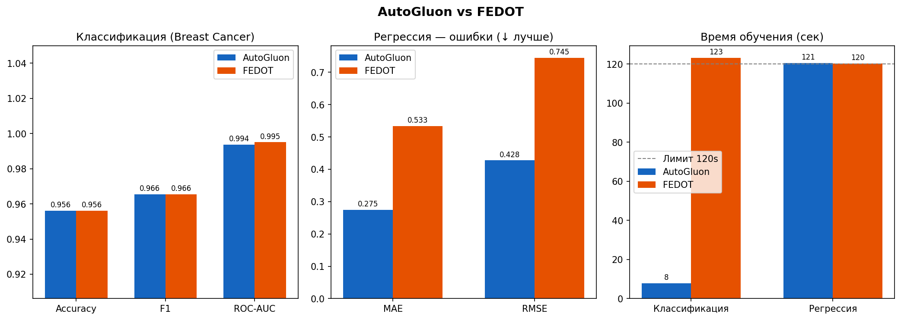

# Отчёт: AutoGluon против FEDOT

## 1. Цель

Сравнить два подхода к AutoML на табличных данных при равном бюджете времени:
стекинг-ансамбли AutoGluon и эволюционный поиск графовых пайплайнов FEDOT. Ответить на вопрос,
когда какой из них стоит выбирать.

## 2. Методы

**AutoGluon (`TabularPredictor`).** Пользователь передаёт таблицу, имя целевой колонки и лимит времени.
Фреймворк обучает набор базовых моделей (LightGBM, CatBoost, XGBoost, Random Forest, Extra Trees,
нейросети, kNN, линейные модели) с bagging и out-of-fold предсказаниями. На их выходах строятся уровни
стекинга, итоговый ответ даёт взвешенный ансамбль. Пайплайн фиксирован, настраивается пресет качества
(здесь `medium_quality`).

**FEDOT.** Решение представляется как граф: узлы — операции предобработки и модели, рёбра — потоки данных.
Эволюционный алгоритм мутирует и скрещивает графы, оценивает их кросс-валидацией и после поиска
настраивает гиперпараметры (`with_tuning=True`). Структура пайплайна не фиксирована и поддаётся анализу,
но поиск требует времени.

## 3. Протокол эксперимента

| Параметр | Значение |
|---|---|
| Бюджет времени | 120 с на задачу и фреймворк |
| Seed | 42 |
| Разбиение | hold-out, 20% на тест (стратификация для классификации) |
| Классификация | Breast Cancer Wisconsin, метрики Accuracy, F1, ROC-AUC |
| Регрессия | California Housing, метрики MAE, RMSE, R² |
| AutoGluon | пресет `medium_quality`, оптимизируемая метрика ROC-AUC / RMSE |
| FEDOT | `cv_folds=3`, `with_tuning=True`, оптимизируемая метрика ROC-AUC / RMSE |
| Операции FEDOT | классификация: logit, rf, knn, dt, mlp; регрессия: linear, ridge, lasso, rf, dt, knn |

Набор операций FEDOT ограничен намеренно, чтобы поиск уложился в бюджет в 2 минуты. Это делает сравнение
менее выгодным для FEDOT, чем запуск с его полным набором моделей. Код запуска: `automl_benchmark/`.

## 4. Результаты

| Задача | Метрика | AutoGluon | FEDOT |
|---|---|---|---|
| Классификация | Accuracy | 0.956 | 0.956 |
| | F1 | 0.966 | 0.966 |
| | ROC-AUC | 0.994 | 0.995 |
| | время, с | 8 | 123 |
| Регрессия | MAE | 0.275 | 0.533 |
| | RMSE | 0.428 | 0.745 |
| | время, с | 121 | 120 |

## 5. Анализ

- **Классификация.** Фреймворки равны по Accuracy и F1, ROC-AUC отличается на 0.001. Одно и то же качество
  AutoGluon получил за 8 с, FEDOT использовал почти весь бюджет (123 с). Бюджет — верхняя граница:
  AutoGluon может закончить раньше, а эволюционный поиск, как правило, работает до таймаута.
- **Регрессия.** AutoGluon заметно точнее: MAE меньше в 1.9 раза, RMSE в 1.7 раза. Вероятные причины:
  стекинг мощных градиентных бустингов против ограниченного набора операций FEDOT, у которого к тому же
  меньше итераций поиска за 2 минуты на 16 512 обучающих объектах.
- **Время.** На регрессии оба фреймворка вышли на лимит (121 и 120 с), то есть сравнение по качеству
  там честное при равном бюджете.

## 6. Ограничения

- Один прогон и один seed: нет оценки разброса, малые различия (ROC-AUC 0.994 против 0.995) не значимы.
- Маленький бюджет (2 минуты). Эволюционному поиску FEDOT, скорее всего, нужно больше времени;
  результаты при 5–30 минутах могут отличаться. Ноутбук использует 5 минут и три задачи.
- Ограниченный набор операций FEDOT (см. выше).
- Сравнивается один пресет AutoGluon.
- Значения в таблице сняты с графика эталонного прогона (3 знака), R² в нём не сохранялся.
  Для воспроизведения с полным `results.json` запустите `python -m automl_benchmark`.

## 7. Выводы и рекомендации

- **AutoGluon** выбирать, когда нужен сильный результат быстро и без ручной настройки: baseline,
  соревнования, прототипы. В эксперименте он не уступил FEDOT ни на одной задаче, а на регрессии заметно выиграл.
- **FEDOT** выбирать, когда важны структура и интерпретируемость пайплайна, нестандартные данные или
  исследовательские задачи, а на поиск есть время. Ожидать от него преимущества при бюджете в 2 минуты не стоит.
- Ни один из фреймворков не заменяет работу с доменными признаками.

## 8. Дальнейшие шаги

- Несколько seed и усреднение с доверительным интервалом.
- Прогон при бюджетах 2, 5, 15 минут: как качество каждого фреймворка растёт со временем.
- Полный набор операций FEDOT и пресеты AutoGluon выше `medium_quality`.
- Больше датасетов, включая временные ряды (код в ноутбуке).
